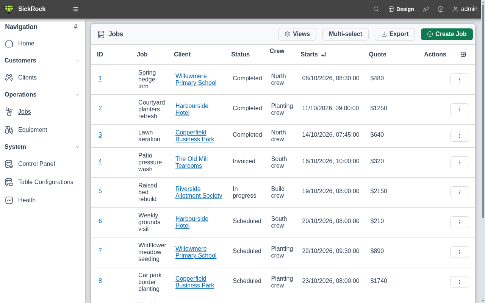
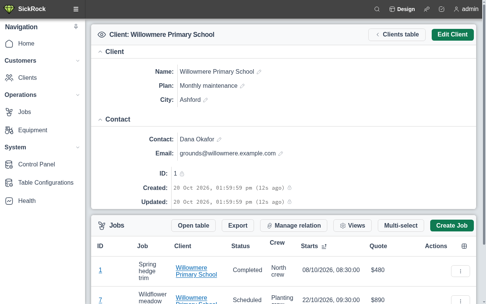
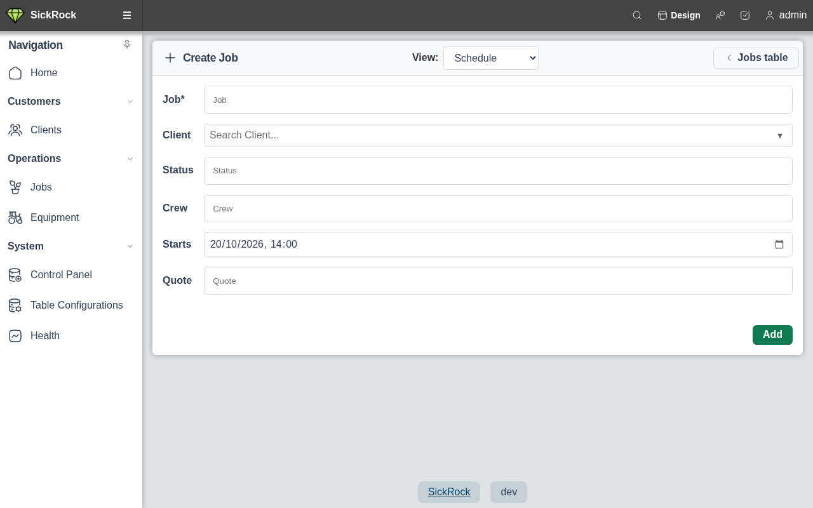
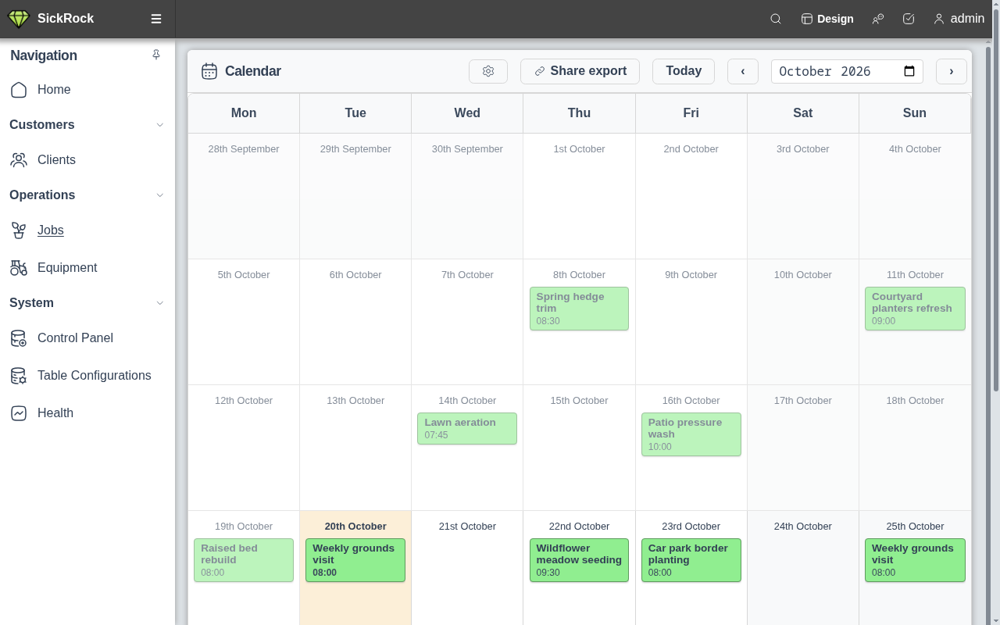
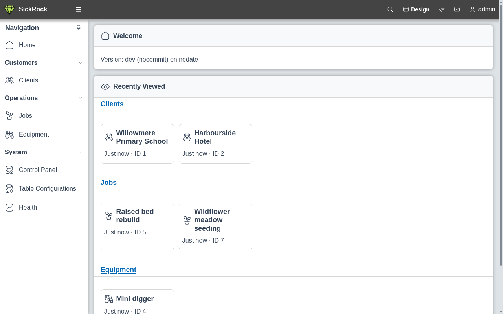
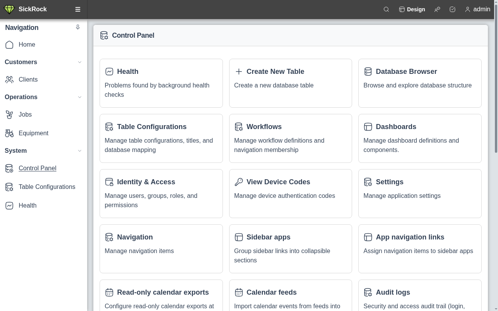
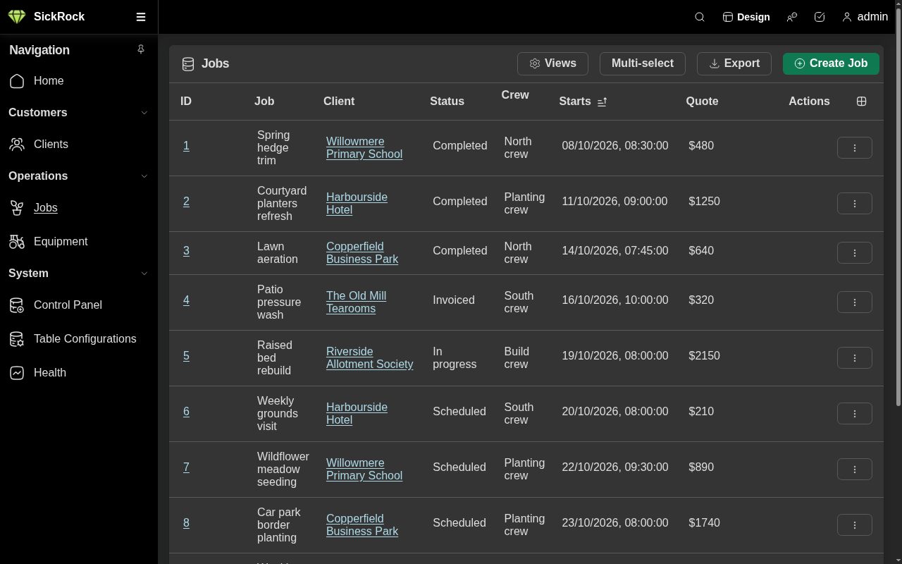

  
  <h1>SickRock</h1>

  Build no-code database web applications on real databases.

[-blue)](https://blog.jread.com/posts/ai-levels-of-autonomy-in-software-engineering/)

SickRock is a no-code database web application builder. Connect SQLite or MySQL, configure tables and views in the UI, and expose data through the web interface, Connect RPC API, OpenAPI spec, or MCP server. It is a Go and Vue reimplementation of the Sicroc LAMP-stack application.

## Screenshots

### Tables on your own database

Browse a real database table as a sortable, filterable list, with friendly column labels, currency formatting and linked records. Saved views let each user choose which columns they see.

### Records with related rows

Each record gets its own page with fields grouped into sections, inline editing, and the rows that reference it (here, a client's jobs) listed underneath.

### Forms for data entry

Add rows through a generated form with date pickers and a searchable picker for linked records, without writing any code.

### Calendar view

Any table with a start date can be shown as a calendar, so schedules and bookings can be planned at a glance and shared as a read-only export.

### Home

The home page brings back the records you looked at most recently, and the sidebar groups your tables into apps such as Customers and Operations.

### Control panel

Administrators manage tables, navigation, dashboards, users, roles and health checks from one control panel, all inside the browser.

### Dark mode

The whole interface is also available in a dark theme.

Screenshots use fictional test data and are regenerated with `make screenshots`
(see [`var/marketing/screenshots`](var/marketing/screenshots/README.md)).

## Installation Guide & Documentation

The SickRock docs can all be found here: [Installation Guide & Documentation](https://jamesread.github.io/SickRock/index.html)

This documentation site is llm.txt compatible: [llm.txt](https://jamesread.github.io/SickRock/llm.txt) and [llm-full.txt](https://jamesread.github.io/SickRock/llm-full.txt).

## AI usage declaration

This is a brief overview of the AI usage for this project. The full AI policy can be found in [AI.md](AI.md).

* **Runtime**: This project makes no usage of any AI models at runtime; no data of any kind is sent to or received from any AI.
* **Development - Writing code**: This project is developed at [AI Autonomy Level 3 of 5 (Semi-Autonomous Engineer)](https://blog.jread.com/posts/ai-levels-of-autonomy-in-software-engineering/). Humans orchestrate specs, architecture, and direction; AI agents implement features, tests, and documentation. Most code is human reviewed before merge, but it is not human written in the traditional sense.
* **Development - Build pipeline**: Linters, code review tools, and others enabled by AI are allowed and encouraged, but as optional tools. No part of the build process may depend on AI tools (for example, code generation).
